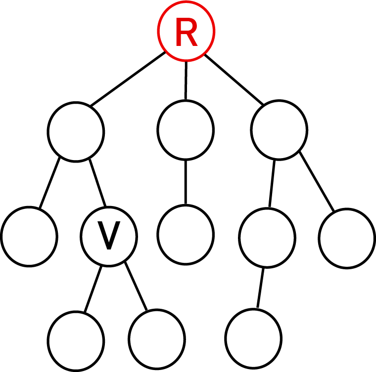
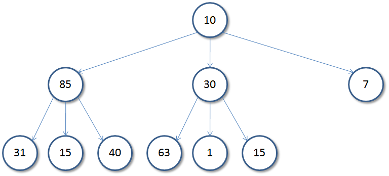
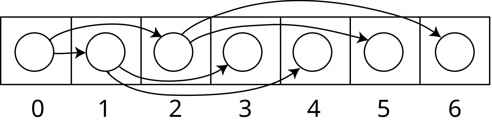
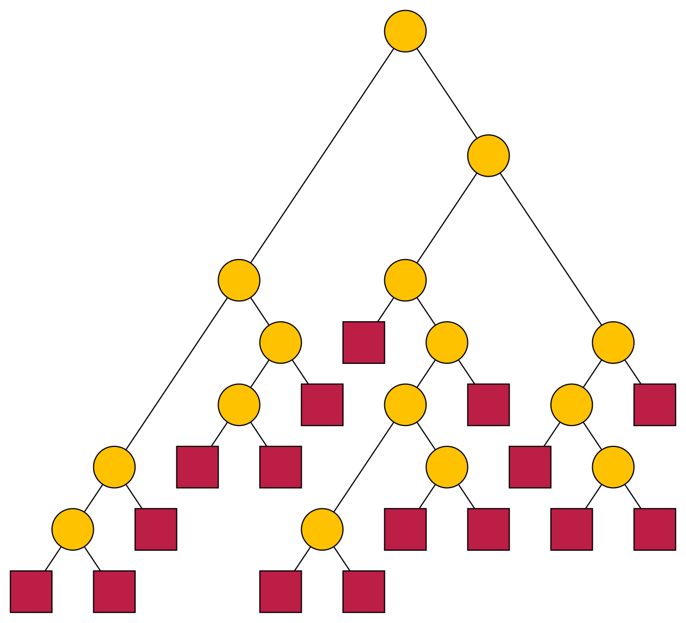
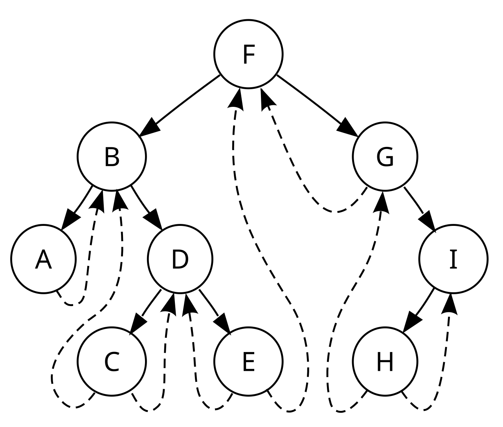
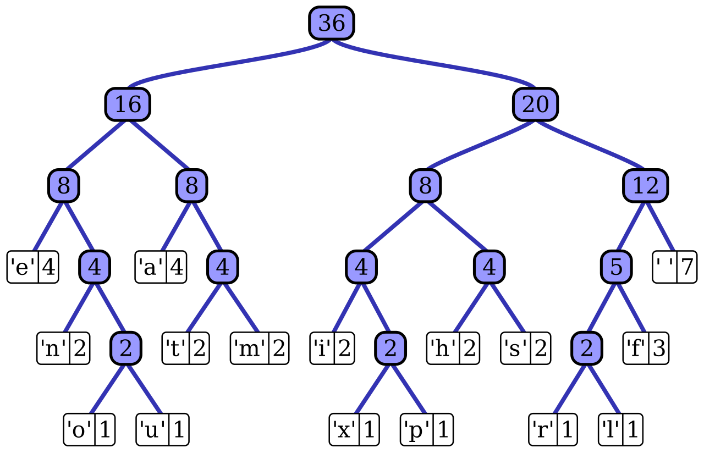

本章是 408 中“概念 + 计算 + 遍历”并重的一章：树与二叉树的性质、完全二叉树的编号和结点数计算是选择题高频点；遍历序列还原、线索二叉树、哈夫曼树和并查集是常考题型。

<Tip>
**先记三个数**：$n_0=n_2+1$；空指针总数为 $n+1$；完全二叉树满足 $2^{h-1}\le n\le 2^h-1$。这三条是本章计算的起点。

复习时按“概念与性质 → 完全二叉树计算 → 遍历与线索 → 转换、哈夫曼与并查集”推进，最后用公式汇总和插图回顾。
</Tip>

## 树的基本概念

<AccordionGroup>
  <Accordion title="树的定义与基本术语">
    **定义**：树是 $n$（$n\ge 0$）个结点的有限集合。

    - $n=0$：空树
    - $n>0$：由一个根结点和若干棵互不相交的子树组成，每棵子树本身也是树

    <Frame caption="树的结构：R 为根，V 为分支结点，圆圈表示树中的结点（图源：Wikimedia Commons，CC0）">
      
    </Frame>

    | 术语 | 含义 |
    | --- | --- |
    | 结点的度 | 结点拥有的孩子个数 |
    | 树的度 | 树中所有结点的最大度 |
    | 叶子结点 | 度为 0 的结点 |
    | 分支结点 | 度不为 0 的结点 |
    | 结点的层次 | 根为第 1 层，向下逐层加 1 |
    | 结点的深度 | 从根到该结点的层数（王道按层数计，根深度为 1） |
    | 结点的高度 | 从该结点到最远叶子的层数（叶子高度为 1） |
    | 树的高度 | 树中结点的最大层数 |
    | 祖先、子孙 | 根到该结点路径上的结点；以该结点为根的子树中的结点 |
    | 森林 | $m$ 棵互不相交的树的集合 |

    <Info>
    **两种约定**：有的教材把深度定义为“根到结点的边数”，此时根深度为 0，树高 = 最大深度 + 1。408 做题以题目约定为准，但同一题内不能混用。
    </Info>
  </Accordion>

  <Accordion title="结点数、度数与边数的关系">
    对任意一棵含 $n$ 个结点的树：

    - 边数 $=n-1$
    - 所有结点的度数之和 $=n-1$
    - 分支结点数 $=n-n_0$

    $$
    n=\sum_{v} d(v)+1
    $$

    其中 $d(v)$ 为结点 $v$ 的度。

    **森林**：含 $n$ 个结点、$m$ 棵树的森林，边数为 $n-m$。

    <Tip>
    已知各度数的结点数，先用“度数之和 = n−1”求 $n$，再用 $n_0=n-\sum_{i\ge1}n_i$ 求叶子。
    </Tip>
  </Accordion>

  <Accordion title="树的三种存储结构（补充）">
    - **双亲表示法**：用数组存储每个结点，每个结点记录双亲下标。找双亲 $O(1)$，找孩子需要遍历
    - **孩子表示法**：数组加每个结点的孩子链表。找孩子方便，找双亲需要遍历
    - **孩子兄弟表示法**：用二叉链表，每个结点两个指针 `firstchild`、`nextsibling`。找孩子、找兄弟都方便

    ```c 孩子兄弟表示法
    typedef struct CSNode {
        ElemType data;
        struct CSNode *firstchild, *nextsibling;
    } CSNode, *CSTree;
    ```

    <Info>
    孩子兄弟表示法就是“左孩子右兄弟”，因此树、森林与二叉树的转换本质上是同一种存储结构的不同视角。
    </Info>
  </Accordion>
</AccordionGroup>

## 二叉树的概念与性质

<AccordionGroup>
  <Accordion title="定义与五种基本形态">
    **定义**：二叉树是 $n$（$n\ge0$）个结点的有限集合，或为空，或由一个根结点和两棵互不相交的左、右子树组成。

    **特点**：

    - 每个结点最多有两棵子树，不存在度大于 2 的结点
    - 左、右子树有次序，不能随意交换
    - 二叉树可以为空

    **五种基本形态**：

    1. 空二叉树
    2. 只有根结点
    3. 只有左子树
    4. 只有右子树
    5. 左、右子树都有

    <Info>
    二叉树是**有序树**，即使只有一个孩子，也要区分它是左孩子还是右孩子；这是二叉树与一般树的重要区别。
    </Info>
  </Accordion>

  <Accordion title="满二叉树">
    **定义**：高度为 $h$ 的二叉树，每一层的结点数都达到最大值。

    - 第 $i$ 层结点数：$2^{i-1}$
    - 总结点数：$n=2^h-1$
    - 叶子结点数：$n_0=2^{h-1}$
    - 度为 2 的结点数：$n_2=2^{h-1}-1$
    - 度为 1 的结点数：$n_1=0$
    - 已知 $n$ 求高度：$h=\log_2(n+1)$

    <Tip>
    满二叉树一定是完全二叉树，完全二叉树不一定是满二叉树。判断满二叉树：$n=2^h-1$。
    </Tip>
  </Accordion>

  <Accordion title="三条核心性质">
    **性质 1**：第 $i$ 层最多有 $2^{i-1}$ 个结点（$i\ge1$）。

    **性质 2**：高度为 $h$ 的二叉树最多有 $2^h-1$ 个结点。

    **性质 3**：对任意非空二叉树，叶子结点数 $n_0$ 与度为 2 的结点数 $n_2$ 满足

    $$
    n_0=n_2+1
    $$

    **推导**：

    - 结点总数 $n=n_0+n_1+n_2$
    - 边数 $n-1=n_1+2n_2$
    - 两式联立得 $n_0=n_2+1$

    <Tip>
    $n_0=n_2+1$ 与树的形态无关，只要是非空二叉树就成立；做题时常用它配合 $n=n_0+n_1+n_2$ 求未知量。
    </Tip>
  </Accordion>

  <Accordion title="结点数与高度的约束（任意二叉树）">
    设二叉树有 $n$ 个结点、高度为 $h$。

    **已知高度 $h$，结点数范围**：

    $$
    h\le n\le 2^h-1
    $$

    最少是每层只有 1 个结点（单支树），最多是满二叉树。

    **已知结点数 $n$，高度范围**：

    $$
    \left\lfloor\log_2 n\right\rfloor+1\le h\le n
    $$

    高度最小当且仅当树是**完全二叉树**；高度最大是单支树。

    <Info>
    完全二叉树是“同样结点数下高度最小”的二叉树，因此它的高度公式 $\lfloor\log_2 n\rfloor+1$ 也是任意二叉树的最小高度。
    </Info>
  </Accordion>
</AccordionGroup>

## 完全二叉树

<AccordionGroup>
  <Accordion title="定义与形态">
    **定义**：除最后一层外，其余各层都达到最大结点数；最后一层的结点**从左向右连续排列**。

    ```mermaid
    graph TD
      n1["1"] --> n2["2"]
      n1 --> n3["3"]
      n2 --> n4["4"]
      n2 --> n5["5"]
      n3 --> n6["6"]
      n3 --> n7["7"]
      n4 --> n8["8"]
      n4 --> n9["9"]
      n5 --> n10["10"]
    ```

    上图是 $n=10$ 的完全二叉树：高度 $h=4$，叶子为 6、7、8、9、10，只有结点 5 的度为 1。

    **重要特征**：

    - 叶子只可能出现在最后两层
    - 最多只有一个度为 1 的结点，且它只有左孩子
    - 结点数 $n$ 与高度 $h$ 满足 $2^{h-1}\le n\le2^h-1$
  </Accordion>

  <Accordion title="叶子与度数构成">
    对 $n$ 个结点的完全二叉树：

    $$
    n_0=\left\lceil\frac{n}{2}\right\rceil,\qquad
    n_1=1-(n\bmod 2),\qquad
    n_2=\left\lfloor\frac{n-1}{2}\right\rfloor
    $$

    其中 $n$ 为偶数时 $n_1=1$，$n$ 为奇数时 $n_1=0$。

    | $n$ 的奇偶性 | $n_0$ | $n_1$ | $n_2$ |
    | --- | --- | --- | --- |
    | 奇数 | $(n+1)/2$ | 0 | $(n-1)/2$ |
    | 偶数 | $n/2$ | 1 | $n/2-1$ |

    图中 $n=10$ 时，$n_0=5$，$n_1=1$，$n_2=4$，且 $n_0=n_2+1$。

    <Warning>
    **高频错误**：不要记成 $n_1=n\bmod2$、$n_2=\lfloor n/2\rfloor$。$n=10$ 时 $n_1=1$（不是 0），$n_2=4$（不是 5）。记住：偶数个结点时有一个度为 1 的结点。
    </Warning>
  </Accordion>

  <Accordion title="已知高度 h，求结点数 n">
    高度为 $h$ 的完全二叉树：

    - 前 $h-1$ 层一定是满的，共有 $2^{h-1}-1$ 个结点
    - 第 $h$ 层至少有 1 个结点，至多有 $2^{h-1}$ 个结点

    因此：

    $$
    2^{h-1}\le n\le 2^h-1
    $$

    **记忆**：下限 = 前 $h-1$ 层满 + 第 $h$ 层 1 个；上限 = 满二叉树。
  </Accordion>

  <Accordion title="已知结点数 n，求高度 h">
    $$
    h=\left\lfloor\log_2 n\right\rfloor+1
    $$

    也可以写成：

    $$
    h=\left\lceil\log_2(n+1)\right\rceil
    $$

    两个公式对正整数 $n$ 等价。

    | $n$ | 8 | 9 | 10 | 15 | 16 |
    | --- | --- | --- | --- | --- | --- |
    | $h$ | 4 | 4 | 4 | 4 | 5 |

    <Warning>
    不要记成 $\lceil\log_2 n\rceil+1$：$n=10$ 时会得到 5，正确结果是 4。
    </Warning>
  </Accordion>

  <Accordion title="不同高度下的结点数范围">
    | 高度 $h$ | 最少结点数 | 最多结点数 |
    | --- | --- | --- |
    | 1 | 1 | 1 |
    | 2 | 2 | 3 |
    | 3 | 4 | 7 |
    | 4 | 8 | 15 |
    | 5 | 16 | 31 |
    | 6 | 32 | 63 |

    **判断高度**：若 $2^{h-1}\le n\le2^h-1$，则完全二叉树的高度就是 $h$。

    如 $n=10$，因为 $8\le10\le15$，所以 $h=4$。
  </Accordion>

  <Accordion title="满二叉树是特例">
    完全二叉树中，若 $n=2^h-1$，则最后一层也是满的，此时它才是满二叉树。

    - 满二叉树：$n=2^h-1$，$n_1=0$
    - 完全二叉树：$2^{h-1}\le n\le2^h-1$，$n_1$ 可能为 0 或 1

    <Tip>
    判断口诀：**完全二叉树看“连续”，满二叉树看“满层”**。满二叉树一定是完全二叉树。
    </Tip>
  </Accordion>

  <Accordion title="编号：从 1 开始">
    按从上到下、同一层从左到右编号，根为 1。

    | 关系 | 编号 |
    | --- | --- |
    | 双亲 | $\lfloor i/2\rfloor$ |
    | 左孩子 | $2i$ |
    | 右孩子 | $2i+1$ |
    | 左兄弟（$i$ 为右孩子时） | $i-1$ |
    | 右兄弟（$i$ 为左孩子时） | $i+1$ |

    **孩子存在条件**：

    $$
    2i\le n,\qquad 2i+1\le n
    $$

    **叶子与分支**：叶子满足 $i>\lfloor n/2\rfloor$，分支满足 $i\le\lfloor n/2\rfloor$。

    - 第一个叶子编号：$\lfloor n/2\rfloor+1$
    - 最后一个分支结点编号：$\lfloor n/2\rfloor$

    <Info>
    $n=10$ 时，叶子为 6～10，分支为 1～5；结点 4 的孩子是 8、9，结点 5 只有左孩子 10。
    </Info>
  </Accordion>

  <Accordion title="编号：从 0 开始">
    按从上到下、同一层从左到右编号，根为 0。

    | 关系 | 编号 |
    | --- | --- |
    | 双亲 | $\lfloor(i-1)/2\rfloor$ |
    | 左孩子 | $2i+1$ |
    | 右孩子 | $2i+2$ |
    | 左兄弟（$i$ 为右孩子时） | $i-1$ |
    | 右兄弟（$i$ 为左孩子时） | $i+1$ |

    **孩子存在条件**：

    $$
    2i+1<n,\qquad 2i+2<n
    $$

    **叶子与分支**：叶子满足 $i\ge\lfloor n/2\rfloor$，分支满足 $i<\lfloor n/2\rfloor$。

    - 第一个叶子编号：$\lfloor n/2\rfloor$
    - 最后一个分支结点编号：$\lfloor n/2\rfloor-1$

    <Info>
    $n=10$ 时，叶子为 5～9，分支为 0～4；结点 4 只有左孩子 9。
    </Info>
  </Accordion>

  <Accordion title="两种编号方式对照">
    | 关系 | 从 1 开始 | 从 0 开始 |
    | --- | --- | --- |
    | 根结点 | 1 | 0 |
    | 双亲 | $\lfloor i/2\rfloor$ | $\lfloor(i-1)/2\rfloor$ |
    | 左孩子 | $2i$ | $2i+1$ |
    | 右孩子 | $2i+1$ | $2i+2$ |
    | 第一个叶子 | $\lfloor n/2\rfloor+1$ | $\lfloor n/2\rfloor$ |
    | 最后一个分支 | $\lfloor n/2\rfloor$ | $\lfloor n/2\rfloor-1$ |

    <Tip>
    同一结点的两套编号相差 1：$i_{1}=i_{0}+1$。若题目没有明说，先看根结点编号是 0 还是 1，再套公式。
    </Tip>

    <Warning>
    以上公式只适用于**按层序连续编号的完全二叉树**；非完全二叉树不能用。
    </Warning>
  </Accordion>
</AccordionGroup>

## 完全 m 叉树

<AccordionGroup>
  <Accordion title="高度与结点数">
    完全 $m$ 叉树：除最后一层外，其余各层都满；最后一层从左到右连续排列。

    <Frame caption="3 叉树示意：每个非叶结点最多有 3 个孩子（图源：Wikimedia Commons，公有领域）">
      
    </Frame>

    - 第 $i$ 层最多：$m^{i-1}$
    - 高度为 $h$ 的满 $m$ 叉树：

    $$
    n=\frac{m^h-1}{m-1}
    $$

    - 完全 $m$ 叉树的高度：

    $$
    h=\left\lceil\log_m\big((m-1)n+1\big)\right\rceil
    $$

    - 高度为 $h$ 时，结点数范围：

    $$
    \frac{m^{h-1}-1}{m-1}+1\le n\le\frac{m^h-1}{m-1}
    $$

    <Info>
    $m=2$ 时退化为二叉树的公式：$n=2^h-1$，$h=\lceil\log_2(n+1)\rceil$（要求 $m\ge2$）。
    </Info>
  </Accordion>

  <Accordion title="编号：从 1 开始">
    根为 1，结点 $i$ 的第 $j$ 个孩子（$1\le j\le m$）：

    $$
    (i-1)m+j+1
    $$

    | 关系 | 编号 |
    | --- | --- |
    | 第 1 个孩子 | $(i-1)m+2$ |
    | 第 $j$ 个孩子 | $(i-1)m+j+1$ |
    | 第 $m$ 个孩子 | $im+1$ |
    | 双亲（$i\ge2$） | $\left\lfloor\dfrac{i-2}{m}\right\rfloor+1$ |
    | 最后一个分支结点（$n\ge2$） | $\left\lfloor\dfrac{n-2}{m}\right\rfloor+1$ |

    <Warning>
    $n=1$ 时整棵树只有根，根是叶子，没有分支结点；最后一个分支公式不适用。
    </Warning>
  </Accordion>

  <Accordion title="编号：从 0 开始">
    根为 0，结点 $i$ 的第 $j$ 个孩子（$1\le j\le m$）：

    $$
    im+j
    $$

    | 关系 | 编号 |
    | --- | --- |
    | 第 1 个孩子 | $im+1$ |
    | 第 $j$ 个孩子 | $im+j$ |
    | 第 $m$ 个孩子 | $im+m$ |
    | 双亲（$i\ge1$） | $\left\lfloor\dfrac{i-1}{m}\right\rfloor$ |
  </Accordion>

  <Accordion title="两种编号对照">
    | 关系 | 从 1 开始 | 从 0 开始 |
    | --- | --- | --- |
    | 根结点 | 1 | 0 |
    | 第 $j$ 个孩子 | $(i-1)m+j+1$ | $im+j$ |
    | 双亲 | $\lfloor(i-2)/m\rfloor+1$ | $\lfloor(i-1)/m\rfloor$ |

    <Warning>
    两套编号只差 1，但孩子和双亲公式不能混用；考试先确认根是 0 还是 1。
    </Warning>
  </Accordion>
</AccordionGroup>

## 二叉树的存储结构

<AccordionGroup>
  <Accordion title="顺序存储">
    用一组连续单元存放结点，按完全二叉树的编号方式对应下标。

    | 关系 | 从 1 开始 | 从 0 开始 |
    | --- | --- | --- |
    | 双亲 | $\lfloor i/2\rfloor$ | $\lfloor(i-1)/2\rfloor$ |
    | 左孩子 | $2i$ | $2i+1$ |
    | 右孩子 | $2i+1$ | $2i+2$ |

    <Frame caption="完全二叉树的顺序存储：数组下标表示父子关系（图源：Wikimedia Commons，公有领域）">
      
    </Frame>

    - 适合**完全二叉树**，空间利用率高
    - 非完全二叉树需要空出位置，单支树最浪费：高度 $h$ 需要 $2^h-1$ 个存储单元
    - 高度 10 的单支树只有 10 个结点，却需要 $2^{10}-1=1023$ 个单元

    <Tip>
    顺序存储的本质是用“数组下标”表示父子关系，因此只对完全二叉树的编号有意义。
    </Tip>
  </Accordion>

  <Accordion title="链式存储（二叉链表）">
    ```c 二叉链表结点
    typedef struct BiTNode {
        ElemType data;
        struct BiTNode *lchild, *rchild;
    } BiTNode, *BiTree;
    ```

    - **优点**：适合任意形态的二叉树，找孩子 $O(1)$
    - **缺点**：找双亲不方便；可以增加 `parent` 指针构成三叉链表
    - 空指针数为 $n+1$，这些空指针正好可以用来做线索

    <Info>
    二叉链表有 $n+1$ 个空指针域，线索二叉树就是把这些空指针改造成前驱/后继线索。
    </Info>
  </Accordion>
</AccordionGroup>

## 二叉树的空指针

<AccordionGroup>
  <Accordion title="空指针总数：n+1">
    非空二叉树有 $n$ 个结点，每个结点有两个指针域，共 $2n$ 个。

    - 非空指针域 = 边数 = $n-1$
    - 空指针域 = $2n-(n-1)=n+1$

    $$
    2n-(n-1)=n+1
    $$

    <Check>
    无论二叉树是什么形态，空指针总数恒为 $n+1$。
    </Check>

    <Frame caption="扩充二叉树：黄色为内部结点，红色为外部结点（对应空指针），红色结点数比内部结点数多 1（图源：Wikimedia Commons，CC0）">
      
    </Frame>
  </Accordion>

  <Accordion title="按结点度数计算">
    | 结点类型 | 左右孩子情况 | 空指针数 |
    | --- | --- | --- |
    | 度为 0 | 都没有 | 2 |
    | 度为 1 | 有一个 | 1 |
    | 度为 2 | 都有 | 0 |

    $$
    n+1=2n_0+n_1
    $$

    **推导**：$n_0=n_2+1$，$n=n_0+n_1+n_2$，代入得 $n+1=2n_0+n_1$。

    <Tip>
    已知 $n_0$、$n_1$ 可直接算空指针；反过来已知空指针和 $n_1$ 也可求 $n_0$。
    </Tip>
  </Accordion>

  <Accordion title="左右空指针分别计算">
    设 $n_{1L}$ 为只有左孩子的结点数，$n_{1R}$ 为只有右孩子的结点数。

    $$
    N_L=n_0+n_{1R},\qquad
    N_R=n_0+n_{1L}
    $$

    因此：

    $$
    N_L+N_R=2n_0+n_{1L}+n_{1R}=2n_0+n_1=n+1
    $$

    <Warning>
    左右空指针数量不一定相等，只有总数恒为 $n+1$。
    </Warning>
  </Accordion>

  <Accordion title="满二叉树与完全二叉树的空指针">
    - 满二叉树高度 $h$：$n=2^h-1$，空指针 $=n+1=2^h$
    - 完全二叉树 $n$ 个结点：空指针仍为 $n+1$

    <Info>
    空指针公式只与结点数 $n$ 有关，与树的形态无关；满二叉树、完全二叉树只是 $n$ 取了特殊值。
    </Info>
  </Accordion>
</AccordionGroup>

## 二叉树的遍历

<AccordionGroup>
  <Accordion title="先序、中序、后序（递归）">
    - 先序：根 → 左 → 右
    - 中序：左 → 根 → 右
    - 后序：左 → 右 → 根

    <CodeGroup>
    ```c 先序遍历
    void PreOrder(BiTree T) {
        if (T != NULL) {
            visit(T);
            PreOrder(T->lchild);
            PreOrder(T->rchild);
        }
    }
    ```

    ```c 中序遍历
    void InOrder(BiTree T) {
        if (T != NULL) {
            InOrder(T->lchild);
            visit(T);
            InOrder(T->rchild);
        }
    }
    ```

    ```c 后序遍历
    void PostOrder(BiTree T) {
        if (T != NULL) {
            PostOrder(T->lchild);
            PostOrder(T->rchild);
            visit(T);
        }
    }
    ```
    </CodeGroup>

    <Tip>
    三种遍历的递归路线相同，区别只在 `visit(T)` 放在左、右子树递归的哪个位置。
    </Tip>
  </Accordion>

  <Accordion title="非递归遍历（栈）">
    以中序为例，用栈模拟递归：

    1. 沿着左孩子一路入栈，直到空
    2. 弹出栈顶并访问
    3. 转向右孩子，重复

    ```c 中序非递归
    void InOrder2(BiTree T) {
        InitStack(S);
        BiTree p = T;
        while (p != NULL || !IsEmpty(S)) {
            if (p != NULL) {
                Push(S, p);
                p = p->lchild;
            } else {
                Pop(S, p);
                visit(p);
                p = p->rchild;
            }
        }
    }
    ```

    - **先序非递归**：入栈前访问；为保证“左 → 右”，先压右孩子，再压左孩子
    - **后序非递归**：按“根 → 右 → 左”访问后整体逆序；或用双栈法
    - 空间复杂度均为 $O(h)$

    <Warning>
    后序非递归最容易写错；考场上优先用“根右左 + 逆序”或双栈法，逻辑更稳。
    </Warning>
  </Accordion>

  <Accordion title="层序遍历（队列）">
    从上到下、从左到右访问：

    1. 根入队
    2. 队头出队并访问
    3. 左右孩子（非空）依次入队
    4. 重复直到队列为空

    - 时间 $O(n)$
    - 空间 $O(w)$，$w$ 为树的最大宽度；最坏 $O(n)$

    <Tip>
    层序遍历就是二叉树的广度优先搜索（BFS），可以求树高、每层结点数、最大宽度。
    </Tip>
  </Accordion>

  <Accordion title="遍历序列对照">
    ```mermaid
    graph TD
      A["A"] --> B["B"]
      A --> C["C"]
      B --> D["D"]
      B --> E["E"]
      C --> F["F"]
      C --> G["G"]
    ```

    | 遍历方式 | 序列 |
    | --- | --- |
    | 先序 | A B D E C F G |
    | 中序 | D B E A F C G |
    | 后序 | D E B F G C A |
    | 层序 | A B C D E F G |

    <Tip>
    手算技巧：先序的第一个是根，后序的最后一个是根，中序用根把左右子树分开。
    </Tip>
  </Accordion>

  <Accordion title="遍历序列与还原二叉树">
    | 已知序列 | 能否唯一确定 |
    | --- | --- |
    | 先序 + 中序 | 可以 |
    | 后序 + 中序 | 可以 |
    | 层序 + 中序 | 可以 |
    | 先序 + 后序 | 一般不可以 |
    | 单独任一种 | 不可以 |

    **前提**：结点值互不相同。

    **为什么先序 + 后序一般不行**：无法区分“只有左孩子”和“只有右孩子”。如先序 AB、后序 BA，可能是 A 的左孩子 B，也可能是 A 的右孩子 B。

    <Info>
    若二叉树中**每个结点的度都是 0 或 2**（没有度为 1 的结点），则先序 + 后序可以唯一确定。
    </Info>

    **还原方法**：

    - 先序 + 中序：先序首元素是根，在中序中分左右，递归还原
    - 后序 + 中序：后序末元素是根，在中序中分左右，递归还原
    - 层序 + 中序：层序首元素是根，在中序中分左右，递归还原
  </Accordion>

  <Accordion title="遍历复杂度">
    | 遍历方式 | 时间复杂度 | 辅助空间 |
    | --- | --- | --- |
    | 先序 | $O(n)$ | $O(h)$ |
    | 中序 | $O(n)$ | $O(h)$ |
    | 后序 | $O(n)$ | $O(h)$ |
    | 层序 | $O(n)$ | $O(w)$ |

    - $h$ 为树高，最坏 $O(n)$（单支树）
    - $w$ 为最大宽度，最坏 $O(n)$（满二叉树最后一层）
  </Accordion>
</AccordionGroup>

## 线索二叉树

<AccordionGroup>
  <Accordion title="基本概念与结构">
    利用二叉链表中的 $n+1$ 个空指针域，存放结点在某种遍历次序下的前驱或后继。

    ```c 线索二叉树结点
    typedef struct ThreadNode {
        ElemType data;
        struct ThreadNode *lchild, *rchild;
        int ltag, rtag;
    } ThreadNode, *ThreadTree;
    ```

    | 标志 | 含义 |
    | --- | --- |
    | `ltag = 0` | `lchild` 指向左孩子 |
    | `ltag = 1` | `lchild` 指向前驱 |
    | `rtag = 0` | `rchild` 指向右孩子 |
    | `rtag = 1` | `rchild` 指向后继 |

    <Frame caption="线索二叉树：虚线为线索指针，把空指针改成前驱/后继（图源：Wikimedia Commons，公有领域）">
      
    </Frame>

    <Tip>
    线索化的过程就是一次遍历：遍历到结点时，把它的空指针改成前驱/后继线索。
    </Tip>
  </Accordion>

  <Accordion title="三种线索二叉树">
    - 先序线索二叉树：按先序次序建立线索
    - 中序线索二叉树：按中序次序建立线索（最常用）
    - 后序线索二叉树：按后序次序建立线索

    <Info>
    三种线索树的区别在于“前驱/后继按哪种遍历次序定义”，结点结构和标志位含义完全相同。
    </Info>
  </Accordion>

  <Accordion title="前驱与后继查找">
    | 类型 | 前驱 | 后继 |
    | --- | --- | --- |
    | 先序线索 | 困难 | 容易 |
    | 中序线索 | 容易 | 容易 |
    | 后序线索 | 容易 | 困难 |

    <Tip>
    **口诀**：先序前驱难，后序后继难，中序两者都容易。
    </Tip>

    **中序线索**（最常考）：

    - 前驱：`ltag = 1` 时是 `lchild`；否则是左子树中最右下的结点
    - 后继：`rtag = 1` 时是 `rchild`；否则是右子树中最左下的结点

    **先序线索**：

    - 后继：有左孩子取左孩子，否则有右孩子取右孩子，否则取右线索
    - 前驱：有左线索直接取；否则通常需要双亲信息（可能是双亲，也可能是双亲左子树中最后访问的结点）

    **后序线索**：

    - 前驱：有右孩子取右孩子，否则有左孩子取左孩子，否则取左线索
    - 后继：有右线索直接取；否则通常需要双亲信息（可能是双亲，也可能是双亲右子树中第一个访问的结点）
  </Accordion>

  <Accordion title="为什么先序前驱、后序后继难">
    **先序前驱**：若结点是双亲的右孩子，前驱是双亲左子树中按先序最后访问的结点，需要沿双亲往回找；没有双亲指针就无法完成。

    **后序后继**：若结点是双亲的左孩子且双亲有右子树，后继是双亲右子树中按后序第一个访问的结点；同样需要双亲信息。

    <Warning>
    中序线索树中，前驱和后继都能只靠线索和左右孩子找到，不需要双亲指针；这也是中序线索最常用的原因。
    </Warning>
  </Accordion>
</AccordionGroup>

## 树、森林与二叉树的转换

<AccordionGroup>
  <Accordion title="树转换为二叉树（左孩子右兄弟）">
    1. 每个结点的第一个孩子作为它的左孩子
    2. 每个结点的下一个兄弟作为它的右孩子
    3. 删除原树中其他孩子之间的连线

    **对应关系**：设 A 的孩子为 B、C、D，B 的孩子为 E、F。

    | 原树关系 | 转换后 |
    | --- | --- |
    | B 是 A 的第一个孩子 | B 是 A 的左孩子 |
    | C 是 B 的下一个兄弟 | C 是 B 的右孩子 |
    | D 是 C 的下一个兄弟 | D 是 C 的右孩子 |
    | E 是 B 的第一个孩子 | E 是 B 的左孩子 |
    | F 是 E 的下一个兄弟 | F 是 E 的右孩子 |

    <Tip>
    转换后，二叉树的根没有右孩子（单棵树转换时）；右链表示“兄弟”，左链表示“第一个孩子”。
    </Tip>
  </Accordion>

  <Accordion title="森林转换为二叉树">
    1. 每棵树分别转换为二叉树
    2. 第一棵树的根作为总根
    3. 后面每棵树的根依次作为前一棵树根的右孩子

    <Info>
    森林中所有树的根在转换后形成一条右链；这是“兄弟关系”的自然延伸。
    </Info>
  </Accordion>

  <Accordion title="遍历对应关系">
    **树的先根遍历**：先访问根，再依次先根遍历每棵子树。

    **树的后根遍历**：先依次后根遍历每棵子树，再访问根。

    **森林的遍历**：森林的先序依次先序遍历每棵树；森林的中序依次后根遍历每棵树。

    | 树或森林 | 对应二叉树的遍历 |
    | --- | --- |
    | 树的先根遍历 | 先序遍历 |
    | 树的后根遍历 | 中序遍历 |
    | 森林的先序遍历 | 先序遍历 |
    | 森林的中序遍历 | 中序遍历 |

    <Warning>
    树没有“中根遍历”；树的后根遍历对应的是二叉树的**中序**，不是后序。
    </Warning>
  </Accordion>
</AccordionGroup>

## 哈夫曼树

<AccordionGroup>
  <Accordion title="基本概念与 WPL">
    给定 $n$ 个带权叶子结点，构造一棵带权路径长度最小的二叉树，称为哈夫曼树（最优二叉树）。

    $$
    WPL=\sum_{i=1}^{n}w_i l_i
    $$

    - $w_i$：第 $i$ 个叶子的权值
    - $l_i$：根到该叶子的路径长度（边数）

    <Info>
    权值越大的叶子应离根越近，权值越小的叶子离根越远，这样总代价最小。
    </Info>

    <Frame caption="哈夫曼树：叶结点为字符及频率，内部结点为权值之和（图源：Wikimedia Commons，公有领域）">
      
    </Frame>
  </Accordion>

  <Accordion title="构造方法">
    1. 从当前结点中选权值最小的两个
    2. 合并为新结点，权值为两者之和
    3. 删除原来的两个结点，把新结点加入
    4. 重复直到只剩一个结点

    **构造过程**（权值 `1 2 3 4 5`）：

    | 步骤 | 合并 | 新集合 |
    | --- | --- | --- |
    | 1 | 1 + 2 = 3 | 3 3 4 5 |
    | 2 | 3 + 3 = 6 | 4 5 6 |
    | 3 | 4 + 5 = 9 | 6 9 |
    | 4 | 6 + 9 = 15 | 15 |

    $$
    WPL=3+6+9+15=33
    $$

    <Tip>
    WPL 也等于构造过程中所有新结点权值之和；用这个性质检查比逐个算叶子深度更快。
    </Tip>
  </Accordion>

  <Accordion title="哈夫曼树的性质">
    - 没有度为 1 的结点，每个非叶子结点的度都为 2
    - $n$ 个叶子对应 $2n-1$ 个总结点、$n-1$ 个非叶子结点
    - 哈夫曼树不唯一（权值相同时合并顺序可不同），但最小 WPL 相同
    - 权值越小的叶子一般越深
    - 哈夫曼编码是最优前缀编码

    <Warning>
    哈夫曼树不唯一，但 WPL 的最小值唯一；不要因为画出不同的树就认为答案错了。
    </Warning>
  </Accordion>

  <Accordion title="哈夫曼编码">
    约定左分支为 0、右分支为 1（也可反过来），从根到叶子的路径就是该字符的编码。

    上述构造的一种编码（权值 1、2、3、4、5）：

    | 权值 | 编码 | 码长 |
    | --- | --- | --- |
    | 1 | 000 | 3 |
    | 2 | 001 | 3 |
    | 3 | 01 | 2 |
    | 4 | 10 | 2 |
    | 5 | 11 | 2 |

    **平均码长**：

    $$
    \frac{1\times3+2\times3+3\times2+4\times2+5\times2}{1+2+3+4+5}=\frac{33}{15}=2.2
    $$

    <Tip>
    平均码长 = $WPL/\sum w_i$；编码不唯一，但最优平均码长相同。
    </Tip>

    <Warning>
    哈夫曼编码是**前缀编码**：任何一个编码都不是另一个编码的前缀，因此解码不会产生歧义。
    </Warning>
  </Accordion>
</AccordionGroup>

## 并查集

<AccordionGroup>
  <Accordion title="基本概念与存储">
    并查集维护若干个不相交集合，支持：

    - `Initial`：初始化
    - `Find`：查找元素所属集合（返回根）
    - `Union`：合并两个集合

    用数组 `S[]` 表示：

    - 根结点的 `S[root]` 为负数，绝对值是集合大小（也可用 -1）
    - 非根结点的 `S[x]` 为双亲下标

    ```c 并查集数组
    int S[MAX_SIZE];
    ```

    <Info>
    如集合 `{0,1,2}` 以 0 为根，可表示为 `S[0] = -3, S[1] = 0, S[2] = 0`。
    </Info>
  </Accordion>

  <Accordion title="Find 与 Union 的实现">
    <CodeGroup>
    ```c Find（路径压缩）
    int Find(int S[], int x) {
        int root = x;
        while (S[root] >= 0) root = S[root];  // 找根
        while (x != root) {                   // 路径压缩
            int parent = S[x];
            S[x] = root;
            x = parent;
        }
        return root;
    }
    ```

    ```c Union（按集合大小合并）
    void Union(int S[], int Root1, int Root2) {
        if (Root1 == Root2) return;
        if (S[Root1] > S[Root2]) {  // Root1 集合更小
            int t = Root1; Root1 = Root2; Root2 = t;
        }
        S[Root1] += S[Root2];       // 合并后的大小
        S[Root2] = Root1;           // Root2 挂到 Root1 下
    }
    ```
    </CodeGroup>

    <Warning>
    `S[Root1] > S[Root2]` 比较的是负数：越负表示集合越大，所以要把较小的集合挂到较大的集合下。
    </Warning>
  </Accordion>

  <Accordion title="两种优化与复杂度">
    - **路径压缩**：`Find` 时把路径上的结点直接挂到根，后续查找更快
    - **按秩/按大小合并**：把较小的树挂到较大的树下，避免树退化成链

    | 操作 | 未优化 | 两种优化后 |
    | --- | --- | --- |
    | Find | $O(n)$ | 均摊 $O(\alpha(n))$ |
    | Union | $O(1)$（已知根） | $O(1)$（已知根） |
    | 空间 | $O(n)$ | $O(n)$ |

    <Info>
    $\alpha(n)$ 是反阿克曼函数，增长极慢，可近似看作常数。
    </Info>

    **应用**：Kruskal 最小生成树、无向图连通分量、等价类合并。
  </Accordion>
</AccordionGroup>

## 公式汇总

<Info>
未特别注明的公式对任意非空二叉树成立；标有“完全二叉树”的公式只适用于完全二叉树，不能套到任意二叉树上。
</Info>

<AccordionGroup>
  <Accordion title="二叉树与完全二叉树">
    | 知识点 | 公式 |
    | --- | --- |
    | 第 $i$ 层最多结点数 | $2^{i-1}$ |
    | 高度 $h$ 最多结点数 | $2^h-1$ |
    | 叶子与度为 2 的结点 | $n_0=n_2+1$ |
    | 完全二叉树叶子数 | $\lceil n/2\rceil$ |
    | 完全二叉树度为 1 的结点 | $n$ 偶 1；$n$ 奇 0 |
    | 完全二叉树度为 2 的结点 | $\lfloor(n-1)/2\rfloor$ |
    | 完全二叉树高度 | $\lfloor\log_2 n\rfloor+1$ |
    | 完全二叉树结点范围 | $2^{h-1}\le n\le2^h-1$ |
    | 空指针总数 | $n+1$ |
    | 按度数计算空指针 | $2n_0+n_1$ |
    | 左右空指针 | $N_L=n_0+n_{1R}$；$N_R=n_0+n_{1L}$ |
  </Accordion>

  <Accordion title="完全二叉树编号">
    | 关系 | 从 1 开始 | 从 0 开始 |
    | --- | --- | --- |
    | 双亲 | $\lfloor i/2\rfloor$ | $\lfloor(i-1)/2\rfloor$ |
    | 左孩子 | $2i$ | $2i+1$ |
    | 右孩子 | $2i+1$ | $2i+2$ |
    | 第一个叶子 | $\lfloor n/2\rfloor+1$ | $\lfloor n/2\rfloor$ |
    | 最后一个分支 | $\lfloor n/2\rfloor$ | $\lfloor n/2\rfloor-1$ |
  </Accordion>

  <Accordion title="完全 m 叉树">
    | 知识点 | 公式 |
    | --- | --- |
    | 第 $i$ 层最多 | $m^{i-1}$ |
    | 满 $m$ 叉树总结点 | $\dfrac{m^h-1}{m-1}$ |
    | 完全 $m$ 叉树高度 | $\left\lceil\log_m((m-1)n+1)\right\rceil$ |
    | 高度 $h$ 的结点范围 | $\dfrac{m^{h-1}-1}{m-1}+1\le n\le\dfrac{m^h-1}{m-1}$ |
    | 最后一个分支（从 1 开始） | $\left\lfloor\dfrac{n-2}{m}\right\rfloor+1$ |
  </Accordion>

  <Accordion title="哈夫曼树与其他">
    | 知识点 | 公式 |
    | --- | --- |
    | 哈夫曼树总结点 | $2n-1$ |
    | 带权路径长度 | $WPL=\sum w_i l_i$ |
    | 平均码长 | $WPL/\sum w_i$ |
    | 森林边数（$n$ 结点、$m$ 棵树） | $n-m$ |
  </Accordion>
</AccordionGroup>

## 高频考点与易错点

<AccordionGroup>
  <Accordion title="408 高频考点">
    | 优先级 | 知识点 | 主要考查内容 |
    | --- | --- | --- |
    | ★★★★★ | 完全二叉树 | 树高、结点数、编号 |
    | ★★★★★ | 二叉树性质 | 结点数、叶子数、度数 |
    | ★★★★★ | 二叉树遍历 | 遍历序列、还原二叉树 |
    | ★★★★★ | 空指针计算 | $n+1$、左右空指针、度数关系 |
    | ★★★★ | 线索二叉树 | 前驱、后继 |
    | ★★★★ | 树与森林 | 转换、遍历对应关系 |
    | ★★★★ | 哈夫曼树 | 构造、WPL、编码 |
    | ★★★★ | 并查集 | `Find`、`Union`、路径压缩 |
    | ★★★★ | 完全 m 叉树 | 编号、树高、结点数 |
  </Accordion>

  <Accordion title="易错点清单">
    | 易错说法 | 正确结论 |
    | --- | --- |
    | 完全二叉树 $n_1=n\bmod2$ | 偶数时 $n_1=1$，奇数时 $n_1=0$ |
    | 完全二叉树 $n_2=\lfloor n/2\rfloor$ | 应为 $\lfloor(n-1)/2\rfloor$ |
    | 完全二叉树高度 $=\lceil\log_2 n\rceil+1$ | 应为 $\lfloor\log_2 n\rfloor+1$ |
    | 空指针总数是 $2n$ | 应为 $n+1$ |
    | 完全二叉树一定是满二叉树 | 错；满二叉树一定是完全二叉树 |
    | 先序 + 后序一定能唯一确定 | 一般不能；没有度为 1 的结点时可以 |
    | 树的后根遍历对应二叉树后序 | 对应中序 |
    | 先序线索的前驱容易找 | 困难；后序线索的后继也困难 |
    | 哈夫曼树有 $2n$ 个结点 | 有 $2n-1$ 个 |
    | 哈夫曼树唯一 | 不唯一，但最小 WPL 相同 |
    | 并查集 `Find` 一定 $O(1)$ | 未优化 $O(n)$，优化后均摊 $O(\alpha(n))$ |
    | 0 开始编号的第一个叶子是 $\lfloor n/2\rfloor+1$ | 应为 $\lfloor n/2\rfloor$ |
  </Accordion>
</AccordionGroup>

<Tip>
**做题顺序**：先判断题目说的是“任意二叉树”还是“完全二叉树”，再决定用哪套公式；遇到编号题，先确认根是 0 还是 1；遇到空指针题，先想 $n+1$ 和 $2n_0+n_1$。
</Tip>
