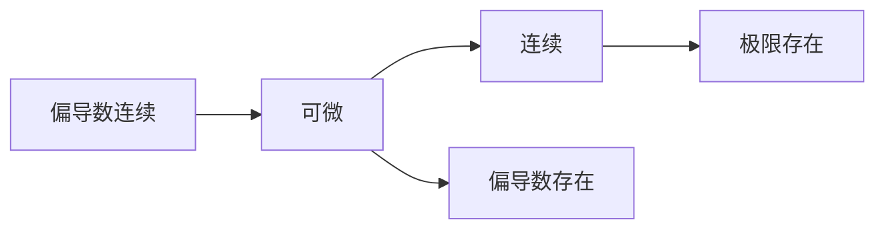

本章整理一元与多元函数的极限、连续、可导、可微之间的关系，共 20 个箭头。

<Info>
**全章主线**：

- 一元：**可导 $\iff$ 可微 $\Rightarrow$ 连续 $\Rightarrow$ 极限存在**，箭头都不可逆；
- 多元：**偏导数连续 $\Rightarrow$ 可微 $\Rightarrow$ 连续 $\Rightarrow$ 极限存在**，并且**可微 $\Rightarrow$ 偏导数存在**；但“连续 + 偏导数存在”推不出可微。

**两个必须记住的反例**：一元用 $\lvert x\rvert$ 说明“连续不可导”；多元用 $\dfrac{xy}{\sqrt{x^2+y^2}}$ 说明“连续且偏导数存在仍不可微”。
</Info>

## 一元函数

设一元函数 $y=f(x)$ 在 $x_0$ 的某个邻域内有定义，且 $f(x_0)$ 为有限实数。记

$$
\Delta x=x-x_0,\qquad \Delta y=f(x_0+\Delta x)-f(x_0)
$$

图中只画出了成立的推出关系；**未画出的箭头（如连续推可微）都不成立**，下面逐条给出证明或反例。

<AccordionGroup>
  <Accordion title="极限存在">
    若存在有限常数 $A$，使沿 $x\to x_0$ 的任意方式都有

    $$
    \lim_{x\to x_0}f(x)=A
    $$

    则称 $f$ 在 $x_0$ 处的极限存在。

    注意：本章所说的极限都是有限极限，$A=+\infty$ 不算极限存在。
  </Accordion>

  <Accordion title="连续">
    若

    $$
    \lim_{x\to x_0}f(x)=f(x_0)
    $$

    则称 $f$ 在 $x_0$ 处连续。

    连续 = 极限存在 + 极限值恰好等于函数值。两个条件缺一不可。
  </Accordion>

  <Accordion title="可导">
    若差商的极限

    $$
    f'(x_0)=\lim_{\Delta x\to0}\frac{\Delta y}{\Delta x}
    =\lim_{x\to x_0}\frac{f(x)-f(x_0)}{x-x_0}
    $$

    存在且有限，则称 $f$ 在 $x_0$ 处可导，该极限值就是导数 $f'(x_0)$。

    差商中的 $\Delta x$ 可以正可以负，所以可导等价于**左右导数都存在且相等**。
  </Accordion>

  <Accordion title="可微">
    若存在与 $\Delta x$ 无关的常数 $A$，使

    $$
    \Delta y=A\Delta x+o(\Delta x)
    $$

    则称 $f$ 在 $x_0$ 处可微。其中 $o(\Delta x)$ 表示比 $\Delta x$ 高阶的无穷小，即

    $$
    \lim_{\Delta x\to0}\frac{o(\Delta x)}{\Delta x}=0
    $$

    线性主部 $A\Delta x$ 就是微分，记作 $dy=A\,dx$。常数 $A$ 必须与 $\Delta x$ 无关，这一点是“线性”的含义。

    <Info>
    可微定义中的常数 $A$ 到底等于什么？下面的 ③④ 证明会给出答案：$A=f'(x_0)$。所以在使用可微定义时，可以一开始就把 $A$ 写成 $f'(x_0)$。
    </Info>
  </Accordion>

  <Accordion title="① 可微 ⇒ 连续">
    由可微的定义，存在常数 $A$，使

    $$
    \Delta y=A\Delta x+o(\Delta x)
    $$

    根据 $o(\Delta x)$ 的定义，$\dfrac{o(\Delta x)}{\Delta x}\to0$。而 $\Delta x\to0$，所以

    $$
    o(\Delta x)=\Delta x\cdot\frac{o(\Delta x)}{\Delta x}\to0
    $$

    于是

    $$
    \lim_{\Delta x\to0}\Delta y
    =\lim_{\Delta x\to0}\left[A\Delta x+o(\Delta x)\right]=0
    $$

    即

    $$
    \lim_{\Delta x\to0}\left[f(x_0+\Delta x)-f(x_0)\right]=0
    $$

    由于 $f(x_0)$ 是有限常数，可以移项得

    $$
    \lim_{\Delta x\to0}f(x_0+\Delta x)=f(x_0)
    $$

    令 $x=x_0+\Delta x$，当 $\Delta x\to0$ 时 $x\to x_0$，故

    $$
    \lim_{x\to x_0}f(x)=f(x_0)
    $$

    符合连续的定义。结论：

    **可微 $\Rightarrow$ 连续。**
  </Accordion>

  <Accordion title="② 连续 ⇏ 可微">
    反例取

    $$
    f(x)=\lvert x\rvert,\qquad x_0=0
    $$

    第一步，证明连续。因为

    $$
    \lim_{x\to0}\lvert x\rvert=0=f(0)
    $$

    所以 $f$ 在原点连续。

    第二步，证明不可微。函数增量为

    $$
    \Delta y=f(0+\Delta x)-f(0)=\lvert\Delta x\rvert
    $$

    差商为

    $$
    \frac{\Delta y}{\Delta x}
    =\frac{\lvert\Delta x\rvert}{\Delta x}
    =\begin{cases}
    1, & \Delta x>0\\[4pt]
    -1, & \Delta x<0
    \end{cases}
    $$

    所以

    $$
    \lim_{\Delta x\to0^+}\frac{\Delta y}{\Delta x}=1,\qquad
    \lim_{\Delta x\to0^-}\frac{\Delta y}{\Delta x}=-1
    $$

    左右极限不相等，差商的极限不存在，故 $f$ 在原点不可导。

    又因为一元函数可导与可微等价（见 ③④），所以 $f$ 在原点也不可微。结论：

    **连续 $\nRightarrow$ 可微。**

    <Warning>
    ② 的反例与 ⑥ 是同一个函数，但说明的是不同箭头的失败：② 关心“连续推不出可微”，⑥ 关心“连续推不出可导”。由于一元中可导与可微等价，这两件事本质上是同一件事。
    </Warning>
  </Accordion>

  <Accordion title="③ 可微 ⇒ 可导">
    设 $f$ 在 $x_0$ 处可微，则存在常数 $A$，使

    $$
    \Delta y=A\Delta x+o(\Delta x)
    $$

    当 $\Delta x\ne0$ 时，两边除以 $\Delta x$：

    $$
    \frac{\Delta y}{\Delta x}=A+\frac{o(\Delta x)}{\Delta x}
    $$

    令 $\Delta x\to0$。由 $o(\Delta x)$ 的定义，

    $$
    \lim_{\Delta x\to0}\frac{o(\Delta x)}{\Delta x}=0
    $$

    因此

    $$
    \lim_{\Delta x\to0}\frac{\Delta y}{\Delta x}=A
    $$

    $A$ 是有限常数，所以导数存在，且

    $$
    f'(x_0)=A
    $$

    结论：**可微 $\Rightarrow$ 可导**，并且可微定义中的系数就是导数。
  </Accordion>

  <Accordion title="④ 可导 ⇒ 可微">
    这是证明一元函数“可导与可微等价”的关键一步。

    由可导的定义，

    $$
    \lim_{\Delta x\to0}\frac{\Delta y}{\Delta x}=f'(x_0)
    $$

    定义辅助函数

    $$
    \alpha(\Delta x)=
    \begin{cases}
    \dfrac{\Delta y}{\Delta x}-f'(x_0), & \Delta x\ne0\\[8pt]
    0, & \Delta x=0
    \end{cases}
    $$

    由于 $f$ 在 $x_0$ 处可导，且 $f'(x_0)$ 为有限常数，故

    $$
    \lim_{\Delta x\to0}\alpha(\Delta x)=0
    $$

    当 $\Delta x\ne0$ 时，由 $\alpha$ 的定义，

    $$
    \frac{\Delta y}{\Delta x}=f'(x_0)+\alpha(\Delta x)
    $$

    两边乘以 $\Delta x$：

    $$
    \Delta y=f'(x_0)\Delta x+\alpha(\Delta x)\Delta x
    $$

    当 $\Delta x=0$ 时，两边都是 $0$，所以上式对一切 $\Delta x$ 成立。

    接下来验证余项是高阶无穷小：

    $$
    \lim_{\Delta x\to0}\frac{\alpha(\Delta x)\Delta x}{\Delta x}
    =\lim_{\Delta x\to0}\alpha(\Delta x)=0
    $$

    按定义，

    $$
    \alpha(\Delta x)\Delta x=o(\Delta x)
    $$

    所以

    $$
    \Delta y=f'(x_0)\Delta x+o(\Delta x)
    $$

    这正是可微的定义，且线性主部的系数就是 $f'(x_0)$。结论：**可导 $\Rightarrow$ 可微。**

    **等价结论。** 综合 ③④，

    $$
    \text{一元函数在一点可导}\iff\text{在该点可微}
    $$

    并且微分为

    $$
    dy=f'(x_0)\,dx
    $$

    <Info>
    一元函数中“可导”与“可微”是同一件事的两种说法：可导说的是差商极限存在，可微说的是增量能拆成线性主部加高阶无穷小，而 ③④ 说明这两种描述互相等价。**这个等价关系只在多元函数的特殊情形下才部分保留，不能照搬到多元。**
    </Info>
  </Accordion>

  <Accordion title="⑤ 可导 ⇒ 连续">
    **方法一：极限乘积法则。**

    若 $f$ 在 $x_0$ 处可导，则

    $$
    \lim_{\Delta x\to0}\frac{\Delta y}{\Delta x}=f'(x_0)
    $$

    其中 $f'(x_0)$ 有限。当 $\Delta x\ne0$ 时，

    $$
    \Delta y=\frac{\Delta y}{\Delta x}\cdot\Delta x
    $$

    两个因子的极限都存在且有限，由极限乘积法则，

    $$
    \begin{aligned}
    \lim_{\Delta x\to0}\Delta y
    &=\lim_{\Delta x\to0}\left(\frac{\Delta y}{\Delta x}\cdot\Delta x\right)\\
    &=f'(x_0)\cdot0\\
    &=0
    \end{aligned}
    $$

    所以 $\lim_{\Delta x\to0}f(x_0+\Delta x)=f(x_0)$，即 $f$ 在 $x_0$ 处连续。

    **方法二：局部有界性与夹逼定理。**

    因为 $\dfrac{\Delta y}{\Delta x}\to f'(x_0)$ 且极限有限，由极限的局部有界性，存在 $M>0$ 与 $\delta>0$，当 $0<\lvert\Delta x\rvert<\delta$ 时

    $$
    \left\lvert\frac{\Delta y}{\Delta x}\right\rvert\le M
    $$

    于是

    $$
    \lvert\Delta y\rvert
    =\left\lvert\frac{\Delta y}{\Delta x}\right\rvert\lvert\Delta x\rvert
    \le M\lvert\Delta x\rvert
    $$

    而 $M\lvert\Delta x\rvert\to0$，由夹逼定理得 $\lvert\Delta y\rvert\to0$，即 $\Delta y\to0$，故 $f$ 在 $x_0$ 处连续。

    结论：**可导 $\Rightarrow$ 连续。**
  </Accordion>

  <Accordion title="⑥ 连续 ⇏ 可导">
    反例仍取

    $$
    f(x)=\lvert x\rvert
    $$

    第一步，在 $x=0$ 处

    $$
    \lim_{x\to0}\lvert x\rvert=0=f(0)
    $$

    所以 $f$ 连续。

    第二步，计算左右导数。左导数：

    $$
    \begin{aligned}
    f'_-(0)
    &=\lim_{x\to0^-}\frac{\lvert x\rvert-0}{x-0}\\
    &=\lim_{x\to0^-}\frac{-x}{x}\\
    &=-1
    \end{aligned}
    $$

    右导数：

    $$
    \begin{aligned}
    f'_+(0)
    &=\lim_{x\to0^+}\frac{\lvert x\rvert-0}{x-0}\\
    &=\lim_{x\to0^+}\frac{x}{x}\\
    &=1
    \end{aligned}
    $$

    因此 $f'_-(0)\ne f'_+(0)$，$f$ 在原点不可导。结论：

    **连续 $\nRightarrow$ 可导。**
  </Accordion>

  <Accordion title="⑦ 连续 ⇒ 极限存在">
    根据连续的定义，

    $$
    \lim_{x\to x_0}f(x)=f(x_0)
    $$

    由于 $f(x_0)$ 是确定的有限实数，所以极限存在，且极限值等于函数值。结论：

    **连续 $\Rightarrow$ 极限存在。**
  </Accordion>

  <Accordion title="⑧ 极限存在 ⇏ 连续">
    反例取

    $$
    f(x)=
    \begin{cases}
    0, & x\ne0\\
    1, & x=0
    \end{cases}
    $$

    在 $x=0$ 处，

    $$
    \lim_{x\to0^-}f(x)=0,\qquad \lim_{x\to0^+}f(x)=0
    $$

    所以 $\lim_{x\to0}f(x)=0$，极限存在。但 $f(0)=1$，于是

    $$
    \lim_{x\to0}f(x)\ne f(0)
    $$

    因此 $f$ 在原点不连续。结论：

    **极限存在 $\nRightarrow$ 连续。**

    <Info>
    ⑧ 说明“极限存在”只描述函数在 $x_0$ **附近**的性态，与 $x_0$ 这一点的函数值无关；而连续要求二者相等。因此只要改动一个点的函数值，就能让连续失效。
    </Info>
  </Accordion>

  <Accordion title="⑨ 可导 ⇒ 极限存在">
    由 ⑤ 已证

    $$
    \text{可导}\Rightarrow\text{连续}
    $$

    由 ⑦ 已证

    $$
    \text{连续}\Rightarrow\text{极限存在}
    $$

    利用推出关系的传递性，

    $$
    \text{可导}\Rightarrow\text{连续}\Rightarrow\text{极限存在}
    $$

    而且极限值满足

    $$
    \lim_{x\to x_0}f(x)=f(x_0)
    $$

    结论：**可导 $\Rightarrow$ 极限存在。**
  </Accordion>

  <Accordion title="⑩ 极限存在 ⇏ 可导">
    反例仍取 $f(x)=\lvert x\rvert$。在 $x=0$ 处

    $$
    \lim_{x\to0}\lvert x\rvert=0
    $$

    极限存在。但由 ⑥ 的计算，

    $$
    f'_-(0)=-1,\qquad f'_+(0)=1
    $$

    左右导数不相等，所以 $f$ 在原点不可导。结论：

    **极限存在 $\nRightarrow$ 可导。**
  </Accordion>

  <Accordion title="补充：拉格朗日中值定理">
    **定理。** 若 $f$ 在闭区间 $[a,b]$ 上连续、在开区间 $(a,b)$ 内可导，则存在 $\xi\in(a,b)$，使

    $$
    \frac{f(b)-f(a)}{b-a}=f'(\xi)
    $$

    证明（由罗尔定理得到）。令

    $$
    F(x)=f(x)-f(a)-\frac{f(b)-f(a)}{b-a}(x-a)
    $$

    则 $F$ 在 $[a,b]$ 上连续、在 $(a,b)$ 内可导，且

    $$
    F(a)=0,\qquad F(b)=0
    $$

    由罗尔定理，存在 $\xi\in(a,b)$ 使 $F'(\xi)=0$。而

    $$
    F'(x)=f'(x)-\frac{f(b)-f(a)}{b-a}
    $$

    故

    $$
    f'(\xi)=\frac{f(b)-f(a)}{b-a}
    $$

    <Tip>
    下面的多元部分 ① 会用到它：证明“偏导数连续 $\Rightarrow$ 可微”时，把二元增量拆成两段，对每一段分别对 $x$、$y$ 使用一次拉格朗日中值定理。
    </Tip>
  </Accordion>

  <Accordion title="一元函数小结">
    $$
    \text{可导}\iff\text{可微}\Rightarrow\text{连续}\Rightarrow\text{极限存在}
    $$

    在没有附加条件时，向右的箭头都不能反过来。判断一元函数的关系题，只需记住：可导与可微是同一件事，连续是它们的必要条件，极限存在又是连续的必要条件。
  </Accordion>

</AccordionGroup>

## 多元函数

以下以二元函数 $z=f(x,y)$ 为例。设 $f$ 在点 $P_0=(x_0,y_0)$ 的某个开邻域内有定义，且 $f(x_0,y_0)$ 有限。记

$$
\Delta x=h,\qquad \Delta y=k,\qquad \rho=\sqrt{h^2+k^2}
$$

$$
\Delta z=f(x_0+h,y_0+k)-f(x_0,y_0)
$$

实线可以推出。**其余方向（包括“连续 + 偏导数存在推可微”）都不成立**，下面逐条说明。

<AccordionGroup>
  <Accordion title="二重极限存在">
    若存在有限常数 $A$，使当 $(x,y)$ 以**任意方式**趋近 $(x_0,y_0)$ 时都有

    $$
    \lim_{(x,y)\to(x_0,y_0)}f(x,y)=A
    $$

    则称 $f$ 在 $P_0$ 处的二重极限存在。

    “任意方式”是多元极限与一元极限最大的区别：一元只有左右两个方向，多元有无穷多条路径。
  </Accordion>

  <Accordion title="连续">
    若

    $$
    \lim_{(x,y)\to(x_0,y_0)}f(x,y)=f(x_0,y_0)
    $$

    则称 $f$ 在 $P_0$ 处连续。
  </Accordion>

  <Accordion title="偏导数存在">
    若

    $$
    f_x(x_0,y_0)=\lim_{h\to0}\frac{f(x_0+h,y_0)-f(x_0,y_0)}{h}
    $$

    $$
    f_y(x_0,y_0)=\lim_{k\to0}\frac{f(x_0,y_0+k)-f(x_0,y_0)}{k}
    $$

    都存在且有限，则称 $f$ 在 $P_0$ 处的一阶偏导数存在。

    偏导数只让一个变量单独变化，另一个变量固定，因此它只描述沿两条坐标轴方向的变化率，**不包含其他方向的信息**。
  </Accordion>

  <Accordion title="可微">
    若存在与 $h,k$ 无关的常数 $A,B$，使

    $$
    \Delta z=Ah+Bk+o(\rho),\qquad
    \lim_{(h,k)\to(0,0)}\frac{o(\rho)}{\rho}=0
    $$

    则称 $f$ 在 $P_0$ 处可微。

    若 $f$ 可微，则必有 $A=f_x(x_0,y_0)$，$B=f_y(x_0,y_0)$（见 ⑤）。因此判断可微不必猜 $A,B$：先算两个偏导数，再验证

    $$
    \lim_{(h,k)\to(0,0)}
    \frac{f(x_0+h,y_0+k)-f(x_0,y_0)-f_x(x_0,y_0)h-f_y(x_0,y_0)k}
    {\sqrt{h^2+k^2}}=0
    $$

    这就是多元函数可微的充要判别式。
  </Accordion>

  <Accordion title="① 偏导数连续 ⇒ 可微">
    这是多元函数可微最重要的充分条件。

    条件：设 $f_x,f_y$ 在 $P_0$ 的某个邻域内存在，并且在 $P_0$ 处连续。

    第一步，拆分增量。

    $$
    \begin{aligned}
    \Delta z={}&f(x_0+h,y_0+k)-f(x_0,y_0+k)\\
    &+f(x_0,y_0+k)-f(x_0,y_0)
    \end{aligned}
    $$

    第二步，对两项分别用拉格朗日中值定理。

    固定 $y=y_0+k$，定义一元函数

    $$
    g(x)=f(x,y_0+k)
    $$

    由于 $f_x$ 在 $P_0$ 附近存在，$g$ 在相应区间内可导，从而连续，满足拉格朗日中值定理的条件。当 $h\ne0$ 时，存在 $0<\theta_1<1$，使

    $$
    f(x_0+h,y_0+k)-f(x_0,y_0+k)
    =f_x(x_0+\theta_1h,\ y_0+k)\,h
    $$

    同理，固定 $x=x_0$，定义 $q(y)=f(x_0,y)$。由于 $f_y$ 在附近存在，当 $k\ne0$ 时存在 $0<\theta_2<1$，使

    $$
    f(x_0,y_0+k)-f(x_0,y_0)
    =f_y(x_0,\ y_0+\theta_2k)\,k
    $$

    当 $h=0$ 或 $k=0$ 时，对应的增量项本身就是 $0$，下面的等式仍然成立（此时相应的 $\theta_i$ 可在 $(0,1)$ 内任取）。于是

    $$
    \Delta z=f_x(x_0+\theta_1h,y_0+k)\,h
    +f_y(x_0,y_0+\theta_2k)\,k
    $$

    第三步，利用偏导数的连续性。记

    $$
    \varepsilon_1(h,k)=f_x(x_0+\theta_1h,y_0+k)-f_x(x_0,y_0)
    $$

    $$
    \varepsilon_2(h,k)=f_y(x_0,y_0+\theta_2k)-f_y(x_0,y_0)
    $$

    因为 $0<\theta_1,\theta_2<1$，当 $(h,k)\to(0,0)$ 时

    $$
    (x_0+\theta_1h,\ y_0+k)\to(x_0,y_0),\qquad
    (x_0,\ y_0+\theta_2k)\to(x_0,y_0)
    $$

    由 $f_x,f_y$ 在 $P_0$ 处连续，

    $$
    \varepsilon_1\to0,\qquad \varepsilon_2\to0
    $$

    代入增量公式：

    $$
    \Delta z=f_x(x_0,y_0)h+f_y(x_0,y_0)k+\varepsilon_1h+\varepsilon_2k
    $$

    第四步，验证余项是高阶无穷小。记 $R(h,k)=\varepsilon_1h+\varepsilon_2k$，则

    $$
    \begin{aligned}
    \left\lvert\frac{R(h,k)}{\rho}\right\rvert
    &=\left\lvert\frac{\varepsilon_1h+\varepsilon_2k}{\rho}\right\rvert\\
    &\le\lvert\varepsilon_1\rvert\frac{\lvert h\rvert}{\rho}
    +\lvert\varepsilon_2\rvert\frac{\lvert k\rvert}{\rho}
    \end{aligned}
    $$

    因为 $\rho=\sqrt{h^2+k^2}\ge\lvert h\rvert$，$\rho\ge\lvert k\rvert$，所以

    $$
    \frac{\lvert h\rvert}{\rho}\le1,\qquad \frac{\lvert k\rvert}{\rho}\le1
    $$

    因此

    $$
    \left\lvert\frac{R(h,k)}{\rho}\right\rvert
    \le\lvert\varepsilon_1\rvert+\lvert\varepsilon_2\rvert\to0
    $$

    由夹逼定理，

    $$
    \lim_{(h,k)\to(0,0)}\frac{R(h,k)}{\rho}=0
    $$

    即 $R(h,k)=o(\rho)$。最终得到

    $$
    \Delta z=f_x(x_0,y_0)h+f_y(x_0,y_0)k+o(\rho)
    $$

    符合可微的定义。结论：**偏导数连续 $\Rightarrow$ 可微。**

    <Info>
    条件的精确表述是：偏导数在 $P_0$ 的**某邻域内存在**，并在 $P_0$ 处连续。不要求偏导数在整个邻域内处处连续。实际做题时，若 $f$ 是初等函数且偏导数在 $P_0$ 附近有表达式，通常可直接判定可微。
    </Info>
  </Accordion>

  <Accordion title="② 可微 ⇏ 偏导数连续">
    反例取

    $$
    f(x,y)=
    \begin{cases}
    x^2\sin\dfrac1x, & x\ne0\\[6pt]
    0, & x=0
    \end{cases}
    $$

    研究原点 $(0,0)$。

    第一步，计算原点处的偏导数。

    $$
    \begin{aligned}
    f_x(0,0)
    &=\lim_{h\to0}\frac{f(h,0)-f(0,0)}{h}\\
    &=\lim_{h\to0}\frac{h^2\sin(1/h)}{h}\\
    &=\lim_{h\to0}h\sin\frac1h=0
    \end{aligned}
    $$

    因为 $\left\lvert h\sin\dfrac1h\right\rvert\le\lvert h\rvert\to0$。同理

    $$
    f_y(0,0)
    =\lim_{k\to0}\frac{f(0,k)-f(0,0)}{k}
    =\lim_{k\to0}\frac0k=0
    $$

    第二步，验证可微。因为 $f_x(0,0)=f_y(0,0)=0$，只需考察

    $$
    \frac{f(h,k)-f(0,0)-0\cdot h-0\cdot k}{\sqrt{h^2+k^2}}
    =\frac{f(h,k)}{\rho}
    $$

    又因为 $\lvert f(h,k)\rvert\le h^2$，所以

    $$
    0\le\frac{\lvert f(h,k)\rvert}{\rho}
    \le\frac{h^2}{\rho}\le\rho\to0
    $$

    由夹逼定理，该比值趋于 $0$，故 $f$ 在原点可微。

    第三步，证明偏导数不连续。当 $x\ne0$ 时，

    $$
    f_x(x,y)=2x\sin\frac1x-\cos\frac1x
    $$

    取 $x_n=\dfrac1{2n\pi}$，则 $\cos\dfrac1{x_n}=1$，$\sin\dfrac1{x_n}=0$，故

    $$
    f_x(x_n,0)=-1
    $$

    再取 $t_n=\dfrac1{(2n+1)\pi}$，则 $\cos\dfrac1{t_n}=-1$，$\sin\dfrac1{t_n}=0$，故

    $$
    f_x(t_n,0)=1
    $$

    虽然 $x_n\to0$、$t_n\to0$，但 $f_x$ 沿这两个数列趋于不同的值，所以 $\displaystyle\lim_{(x,y)\to(0,0)}f_x(x,y)$ 不存在，$f_x$ 在原点不连续。结论：

    **可微 $\nRightarrow$ 偏导数连续。**

    因此“偏导数连续”是可微的**充分非必要**条件。
  </Accordion>

  <Accordion title="③ 可微 ⇒ 连续">
    若 $f$ 在 $P_0$ 处可微，则

    $$
    \Delta z=Ah+Bk+o(\rho)
    $$

    当 $(h,k)\to(0,0)$ 时，$h\to0$，$k\to0$，$\rho\to0$，所以

    $$
    Ah\to0,\qquad Bk\to0
    $$

    又由 $o(\rho)$ 的定义，$\dfrac{o(\rho)}{\rho}\to0$，故

    $$
    o(\rho)=\rho\cdot\frac{o(\rho)}{\rho}\to0
    $$

    于是

    $$
    \lim_{(h,k)\to(0,0)}\Delta z=0
    $$

    即

    $$
    \lim_{(h,k)\to(0,0)}
    \left[f(x_0+h,y_0+k)-f(x_0,y_0)\right]=0
    $$

    所以

    $$
    \lim_{(x,y)\to(x_0,y_0)}f(x,y)=f(x_0,y_0)
    $$

    $f$ 在 $P_0$ 处连续。结论：**可微 $\Rightarrow$ 连续。**
  </Accordion>

  <Accordion title="④ 连续 ⇏ 可微">
    反例取

    $$
    f(x,y)=\sqrt{x^2+y^2}
    $$

    第一步，证明连续。因为

    $$
    \lim_{(x,y)\to(0,0)}\sqrt{x^2+y^2}=0=f(0,0)
    $$

    所以 $f$ 在原点连续。

    第二步，证明不可微。由偏导数的定义，

    $$
    \begin{aligned}
    f_x(0,0)
    &=\lim_{h\to0}\frac{f(h,0)-f(0,0)}{h}\\
    &=\lim_{h\to0}\frac{\lvert h\rvert}{h}
    \end{aligned}
    $$

    而

    $$
    \lim_{h\to0^-}\frac{\lvert h\rvert}{h}=-1,\qquad
    \lim_{h\to0^+}\frac{\lvert h\rvert}{h}=1
    $$

    左右极限不相等，所以 $f_x(0,0)$ 不存在。

    若 $f$ 在原点可微，则令 $k=0$、两边除以 $h$ 并取极限，就能推出 $f_x(0,0)$ 存在（这正是 ⑤ 的论证）。现在 $f_x(0,0)$ 不存在，故 $f$ 在原点不可微。结论：

    **连续 $\nRightarrow$ 可微。**
  </Accordion>

  <Accordion title="⑤ 可微 ⇒ 偏导数存在">
    设 $f$ 在 $P_0$ 处可微，则存在常数 $A,B$，使

    $$
    \Delta z=Ah+Bk+R(h,k),\qquad
    R(h,k)=o(\rho)
    $$

    即

    $$
    \lim_{(h,k)\to(0,0)}\frac{R(h,k)}{\rho}=0
    $$

    第一步，证明 $f_x$ 存在。令 $k=0$，则 $\rho=\lvert h\rvert$，故

    $$
    f(x_0+h,y_0)-f(x_0,y_0)=Ah+R(h,0)
    $$

    当 $h\ne0$ 时两边除以 $h$：

    $$
    \frac{f(x_0+h,y_0)-f(x_0,y_0)}{h}
    =A+\frac{R(h,0)}{h}
    $$

    由 $\dfrac{R(h,0)}{\lvert h\rvert}\to0$ 得

    $$
    \left\lvert\frac{R(h,0)}{h}\right\rvert
    =\frac{\lvert R(h,0)\rvert}{\lvert h\rvert}\to0
    $$

    因此

    $$
    \lim_{h\to0}\frac{f(x_0+h,y_0)-f(x_0,y_0)}{h}=A
    $$

    即 $f_x(x_0,y_0)=A$。

    第二步，证明 $f_y$ 存在。令 $h=0$，则 $\rho=\lvert k\rvert$，同理可得

    $$
    f_y(x_0,y_0)=B
    $$

    两个偏导数都存在。结论：**可微 $\Rightarrow$ 偏导数存在。**

    并且一旦可微，全微分必定可以写成

    $$
    dz=f_x\,dx+f_y\,dy
    $$

    <Warning>
    ⑤ 是**逆否命题最常用**的一条：只要有一个偏导数不存在，函数就必不可微。例如 ④ 中的 $\sqrt{x^2+y^2}$，无需计算可微判别式，由 $f_x(0,0)$ 不存在即可判定不可微。
    </Warning>
  </Accordion>

  <Accordion title="⑥ 偏导数存在 ⇏ 可微">
    反例取

    $$
    f(x,y)=
    \begin{cases}
    \dfrac{xy}{\sqrt{x^2+y^2}}, & (x,y)\ne(0,0)\\[8pt]
    0, & (x,y)=(0,0)
    \end{cases}
    $$

    第一步，证明偏导数存在。

    $$
    f_x(0,0)
    =\lim_{h\to0}\frac{f(h,0)-f(0,0)}{h}
    =\lim_{h\to0}\frac0h=0
    $$

    $$
    f_y(0,0)
    =\lim_{k\to0}\frac{f(0,k)-f(0,0)}{k}
    =\lim_{k\to0}\frac0k=0
    $$

    两个偏导数都存在。

    第二步，验证可微性。由于 $f_x(0,0)=f_y(0,0)=0$，若可微则必须有

    $$
    \lim_{(h,k)\to(0,0)}
    \frac{f(h,k)-0-0\cdot h-0\cdot k}{\sqrt{h^2+k^2}}=0
    $$

    但是

    $$
    \begin{aligned}
    \frac{f(h,k)}{\sqrt{h^2+k^2}}
    &=\frac{\dfrac{hk}{\sqrt{h^2+k^2}}}{\sqrt{h^2+k^2}}\\
    &=\frac{hk}{h^2+k^2}
    \end{aligned}
    $$

    沿路径 $k=h$（$h\ne0$）：

    $$
    \frac{hk}{h^2+k^2}=\frac{h^2}{2h^2}=\frac12
    $$

    极限不为 $0$，所以不满足可微定义，$f$ 在原点不可微。

    第三步，进一步证明 $f$ 在原点连续。由基本不等式 $2\lvert xy\rvert\le x^2+y^2$，

    $$
    \begin{aligned}
    \lvert f(x,y)\rvert
    &=\frac{\lvert xy\rvert}{\sqrt{x^2+y^2}}\\
    &\le\frac{x^2+y^2}{2\sqrt{x^2+y^2}}\\
    &=\frac{\sqrt{x^2+y^2}}2
    \end{aligned}
    $$

    当 $(x,y)\to(0,0)$ 时右侧趋于 $0$，由夹逼定理

    $$
    \lim_{(x,y)\to(0,0)}f(x,y)=0=f(0,0)
    $$

    所以 $f$ 在原点连续。

    综合两步，这个函数在原点**连续且两个偏导数都存在，却不可微**。结论：

    **连续 + 偏导数存在 $\nRightarrow$ 可微。**

    这是考研数学一中判断多元可微性的经典反例，务必记住函数形式和沿 $y=x$ 得到 $\dfrac12$ 的关键计算。
  </Accordion>

  <Accordion title="⑦ 连续 ⇒ 极限存在">
    根据连续的定义，

    $$
    \lim_{(x,y)\to(x_0,y_0)}f(x,y)=f(x_0,y_0)
    $$

    而 $f(x_0,y_0)$ 是有限常数，所以极限存在。结论：

    **连续 $\Rightarrow$ 极限存在。**
  </Accordion>

  <Accordion title="⑧ 极限存在 ⇏ 连续">
    反例取

    $$
    f(x,y)=
    \begin{cases}
    0, & (x,y)\ne(0,0)\\
    1, & (x,y)=(0,0)
    \end{cases}
    $$

    对任意趋近原点的路径，只要 $(x,y)\ne(0,0)$ 就有 $f(x,y)=0$，所以

    $$
    \lim_{(x,y)\to(0,0)}f(x,y)=0
    $$

    但 $f(0,0)=1$，于是

    $$
    \lim_{(x,y)\to(0,0)}f(x,y)\ne f(0,0)
    $$

    所以 $f$ 在原点不连续。结论：

    **极限存在 $\nRightarrow$ 连续。**
  </Accordion>

  <Accordion title="⑨ 偏导数存在 ⇏ 极限存在">
    反例取

    $$
    f(x,y)=
    \begin{cases}
    \dfrac{xy}{x^2+y^2}, & (x,y)\ne(0,0)\\[8pt]
    0, & (x,y)=(0,0)
    \end{cases}
    $$

    第一步，验证偏导数存在。

    $$
    f_x(0,0)
    =\lim_{h\to0}\frac{f(h,0)-f(0,0)}{h}
    =\lim_{h\to0}\frac0h=0
    $$

    $$
    f_y(0,0)
    =\lim_{k\to0}\frac{f(0,k)-f(0,0)}{k}
    =\lim_{k\to0}\frac0k=0
    $$

    两个偏导数都存在。

    第二步，判断二重极限。沿直线 $y=x$ 趋近原点：

    $$
    f(x,x)=\frac{x^2}{x^2+x^2}=\frac12
    $$

    所以

    $$
    \lim_{x\to0}f(x,x)=\frac12
    $$

    沿直线 $y=0$ 趋近原点：

    $$
    f(x,0)=0
    $$

    所以

    $$
    \lim_{x\to0}f(x,0)=0
    $$

    不同路径得到不同的极限值，因此

    $$
    \lim_{(x,y)\to(0,0)}f(x,y)\ \text{不存在}
    $$

    结论：**偏导数存在 $\nRightarrow$ 极限存在**，当然也推不出连续。这说明：沿两条坐标轴的偏导数都存在，完全不能控制其他方向的性态。
  </Accordion>

  <Accordion title="⑩ 极限存在 ⇏ 偏导数存在">
    反例取

    $$
    f(x,y)=\lvert x\rvert
    $$

    第一步，判断极限。因为

    $$
    0\le\lvert x\rvert\le\sqrt{x^2+y^2}
    $$

    当 $(x,y)\to(0,0)$ 时 $\sqrt{x^2+y^2}\to0$，由夹逼定理

    $$
    \lim_{(x,y)\to(0,0)}\lvert x\rvert=0
    $$

    二重极限存在。

    第二步，判断偏导数。

    $$
    \begin{aligned}
    f_x(0,0)
    &=\lim_{h\to0}\frac{f(h,0)-f(0,0)}{h}\\
    &=\lim_{h\to0}\frac{\lvert h\rvert}{h}
    \end{aligned}
    $$

    其中

    $$
    \lim_{h\to0^-}\frac{\lvert h\rvert}{h}=-1,\qquad
    \lim_{h\to0^+}\frac{\lvert h\rvert}{h}=1
    $$

    左右极限不相等，所以 $f_x(0,0)$ 不存在。虽然

    $$
    f_y(0,0)=\lim_{k\to0}\frac{f(0,k)-f(0,0)}{k}
    =\lim_{k\to0}\frac0k=0
    $$

    但由于 $f_x(0,0)$ 不存在，不能说该点的一阶偏导数存在。结论：

    **极限存在 $\nRightarrow$ 偏导数存在。**
  </Accordion>

  <Accordion title="补充：连续与偏导数存在互不推出">
    原图没有单独画出这组箭头，但它是选择题的常见陷阱，必须掌握。

    **连续 $\nRightarrow$ 偏导数存在。** 仍取 $f(x,y)=\lvert x\rvert$。它在原点连续：

    $$
    \lim_{(x,y)\to(0,0)}\lvert x\rvert=0=f(0,0)
    $$

    但

    $$
    f_x(0,0)=\lim_{h\to0}\frac{\lvert h\rvert}{h}
    $$

    不存在，故偏导数不存在。

    **偏导数存在 $\nRightarrow$ 连续。** 仍取 $f(x,y)=\dfrac{xy}{x^2+y^2}$（原点补 $0$）。原点处

    $$
    f_x(0,0)=f_y(0,0)=0
    $$

    但沿 $y=x$ 的极限为 $\dfrac12$，沿 $y=0$ 的极限为 $0$，二重极限不存在，函数不连续。

    两个方向都不成立，因此

    **连续与偏导数存在互不推出。**

    <Warning>
    一元函数里“可导 $\Rightarrow$ 连续”成立，多元函数里“偏导数存在 $\Rightarrow$ 连续”**不成立**。根本原因：偏导数只约束两条坐标轴方向，而连续要求所有方向同时满足。这是从一元推广到多元时最容易出错的地方。
    </Warning>
  </Accordion>

  <Accordion title="可微性的判定流程">
    判断 $f$ 在 $P_0=(x_0,y_0)$ 是否可微，按以下顺序进行：

    1. **先算两个偏导数。** 用定义计算 $f_x(P_0),f_y(P_0)$，分段函数在原点尤其不能偷懒。
    2. **有一个不存在，直接判定不可微。** 依据 ⑤ 的逆否命题，不必再算判别式。
    3. **两个都存在，计算判别式的极限。**

       $$
       L=\lim_{(h,k)\to(0,0)}
       \frac{\Delta z-f_x(P_0)h-f_y(P_0)k}{\sqrt{h^2+k^2}}
       $$

       $L=0$ 当且仅当 $f$ 在 $P_0$ 可微。
    4. **证明 $L=0$。** 常用夹逼：利用 $\lvert h\rvert\le\rho$、$\lvert k\rvert\le\rho$、$h^2+k^2=\rho^2$ 把分子配成 $\rho$ 的高阶项。也可以先用“偏导数连续”这一充分条件。
    5. **证明 $L\ne0$。** 构造路径，如 $y=x$、$y=kx$、$x=y^2$，使比值趋于非零常数，或使不同路径的极限不同。
  </Accordion>

  <Accordion title="多元函数小结">
    $$
    \text{偏导数连续}\Rightarrow\text{可微}
    \Rightarrow
    \begin{cases}
    \text{连续}\\
    \text{偏导数存在}
    \end{cases}
    $$

    $$
    \text{连续}\Rightarrow\text{极限存在}
    $$

    但

    $$
    \text{连续}+\text{偏导数存在}\nRightarrow\text{可微}
    $$

    可微的判定式统一写成

    $$
    \Delta z=f_x(P_0)h+f_y(P_0)k+o(\rho)
    \iff
    \lim_{(h,k)\to(0,0)}
    \frac{\Delta z-f_x(P_0)h-f_y(P_0)k}{\rho}=0
    $$
  </Accordion>

</AccordionGroup>

## 结论速查

先查关系是否成立，再回到对应条目看证明或反例。

<AccordionGroup>
  <Accordion title="一元函数：10 个箭头">
    | 关系 | 结论 | 证明或反例关键点 |
    | --- | --- | --- |
    | 可微 $\Rightarrow$ 连续 | 成立 | $\Delta y=A\Delta x+o(\Delta x)\to0$ |
    | 连续 $\Rightarrow$ 可微 | 不成立 | $\lvert x\rvert$，原点左右导数不等 |
    | 可微 $\Rightarrow$ 可导 | 成立 | 差商等于 $A+\dfrac{o(\Delta x)}{\Delta x}\to A$ |
    | 可导 $\Rightarrow$ 可微 | 成立 | 构造 $\alpha(\Delta x)\to0$，余项 $\alpha\Delta x=o(\Delta x)$ |
    | 可导 $\Rightarrow$ 连续 | 成立 | 乘积法则 $\Delta y=\dfrac{\Delta y}{\Delta x}\cdot\Delta x$ |
    | 连续 $\Rightarrow$ 可导 | 不成立 | $\lvert x\rvert$，左右导数为 $-1,1$ |
    | 连续 $\Rightarrow$ 极限存在 | 成立 | 连续的定义 |
    | 极限存在 $\Rightarrow$ 连续 | 不成立 | 极限值不等于函数值 |
    | 可导 $\Rightarrow$ 极限存在 | 成立 | 可导 $\Rightarrow$ 连续 $\Rightarrow$ 极限存在 |
    | 极限存在 $\Rightarrow$ 可导 | 不成立 | $\lvert x\rvert$，极限存在而不可导 |
  </Accordion>

  <Accordion title="多元函数：10 个箭头">
    | 关系 | 结论 | 证明或反例关键点 |
    | --- | --- | --- |
    | 偏导数连续 $\Rightarrow$ 可微 | 成立 | 两次中值定理 + 余项估计 |
    | 可微 $\Rightarrow$ 偏导数连续 | 不成立 | $x^2\sin\dfrac1x$，偏导数振荡 |
    | 可微 $\Rightarrow$ 连续 | 成立 | $Ah+Bk+o(\rho)\to0$ |
    | 连续 $\Rightarrow$ 可微 | 不成立 | $\sqrt{x^2+y^2}$，偏导数不存在 |
    | 可微 $\Rightarrow$ 偏导数存在 | 成立 | 分别令 $k=0$、$h=0$ |
    | 偏导数存在 $\Rightarrow$ 可微 | 不成立 | $\dfrac{xy}{\sqrt{x^2+y^2}}$，沿 $y=x$ 余项比值为 $\dfrac12$ |
    | 连续 $\Rightarrow$ 极限存在 | 成立 | 连续的定义 |
    | 极限存在 $\Rightarrow$ 连续 | 不成立 | 极限值不等于函数值 |
    | 偏导数存在 $\Rightarrow$ 极限存在 | 不成立 | $\dfrac{xy}{x^2+y^2}$，路径极限不同 |
    | 极限存在 $\Rightarrow$ 偏导数存在 | 不成立 | $\lvert x\rvert$，$f_x(0,0)$ 不存在 |

    表中的分式反例都按前文方式在原点补充函数值 $0$。
  </Accordion>

  <Accordion title="经典反例一览">
    | 函数 | 在原点处的表现 | 用途 |
    | --- | --- | --- |
    | $f(x)=\lvert x\rvert$ | 连续，左右导数不等 | 一元：连续 $\nRightarrow$ 可导 |
    | $f(x,y)=\lvert x\rvert$ | 极限存在，$f_x(0,0)$ 不存在 | 极限存在 $\nRightarrow$ 偏导数存在 |
    | $f(x,y)=\sqrt{x^2+y^2}$ | 连续，偏导数不存在 | 连续 $\nRightarrow$ 可微 |
    | $f(x,y)=\dfrac{xy}{\sqrt{x^2+y^2}}$ | 连续，两个偏导数均为 $0$，不可微 | 连续 + 偏导数存在 $\nRightarrow$ 可微 |
    | $f(x,y)=\dfrac{xy}{x^2+y^2}$ | 两个偏导数均为 $0$，极限不存在 | 偏导数存在 $\nRightarrow$ 连续，也推不出极限存在 |
    | $f(x,y)=x^2\sin\dfrac1x$ | 可微，$f_x$ 在原点不连续 | 可微 $\nRightarrow$ 偏导数连续 |
    | $f(x,y)=\dfrac{xy^2}{x^2+y^4}$ | 沿任何直线趋于 $0$，沿 $x=y^2$ 趋于 $\dfrac12$ | 二重极限不存在的路径判断 |
  </Accordion>
</AccordionGroup>

## 易错提醒

<AccordionGroup>
  <Accordion title="沿直线判断二重极限不可靠">
    <Warning>
    沿所有直线趋近结果相同，不能说明二重极限存在。取 $f(x,y)=\dfrac{xy^2}{x^2+y^4}$（原点补 $0$），沿任何直线 $y=kx$ 有 $f\to0$，沿 $x=0$ 也有 $f\to0$，但沿抛物线 $x=y^2$ 有

    $$
    f(y^2,y)=\frac{y^4}{y^4+y^4}=\frac12
    $$

    所以二重极限不存在。判断极限不存在要主动构造**曲线**路径；判断存在必须用夹逼或极坐标统一估计。
    </Warning>
  </Accordion>

  <Accordion title="原点处的偏导数必须用定义">
    <Warning>
    求分段函数在原点的偏导数必须用定义。若先求出 $x\ne0$ 时的 $f_x$ 表达式再令 $x\to0$，等于默认 $f_x$ 连续，而 ② 的反例恰好说明这个假设不成立：$f_x$ 在原点根本没有极限。
    </Warning>
  </Accordion>

  <Accordion title="可微定义中的 A、B 必须与 h、k 无关">
    <Warning>
    可微定义中的 $A,B$ 必须与 $h,k$ 无关，且只能是一次项。写成 $\Delta z=Ah+Bk+\varepsilon$ 时，$\varepsilon$ 必须是 $o(\rho)$；若 $\varepsilon$ 只满足 $\varepsilon\to0$，那是连续而不是可微。
    </Warning>
  </Accordion>

  <Accordion title="偏导连续、可微、偏导存在的强弱">
    <Warning>
    “偏导数存在”不等于“偏导数连续”，也不等于“可微”。三者由强到弱的顺序是

    $$
    \text{偏导数连续}\Rightarrow\text{可微}\Rightarrow\text{偏导数存在}
    $$

    反向一律不成立。
    </Warning>
  </Accordion>

  <Accordion title="判断顺序：先必要条件，再定义式">
    <Tip>
    判断一元函数在分界点是否可导时，先看左右导数是否都存在且相等；判断多元函数是否可微时，先看偏导数是否存在。两步都是“先检查必要条件，再检查定义式”。
    </Tip>
  </Accordion>
</AccordionGroup>
